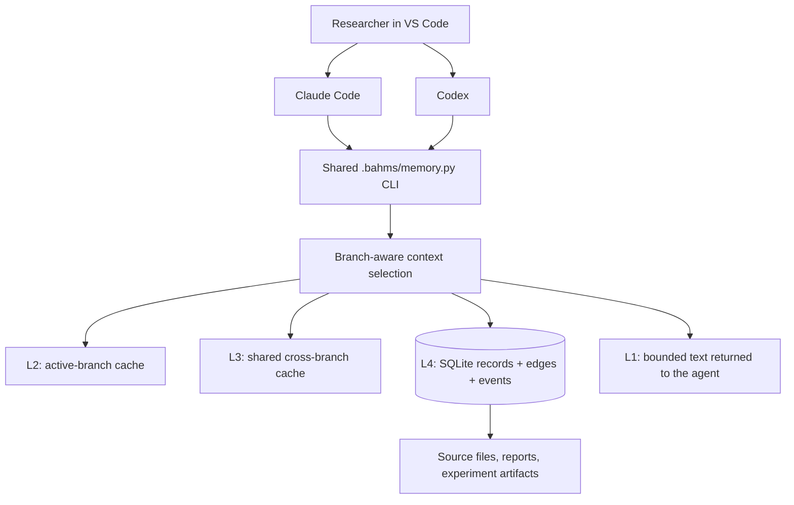

# BAHMS — Branch-Aware Hierarchical Memory System

**Persistent, branch-aware research memory for Claude Code and Codex in VS Code.**

BAHMS is a local-first Python/SQLite add-on that lets AI coding assistants work on long-running research projects without depending on a single conversation's context window. It stores hypotheses, experiments, decisions, evidence references, and checkpoints across sessions. Both assistants can use the **same on-disk project memory** when working in the same repository.

> **MVP status:** BAHMS is an experimental reference implementation, not an autonomous research platform. It currently supports durable records, hypothesis branches, source-linked notes, bounded lexical retrieval, checkpoints, event history, and simple L2/L3 caches. Learned prefetching, vector retrieval, guaranteed automatic capture, and remote synchronization are **not yet implemented**.

## Why BAHMS?

An LLM's context is temporary. Long research projects are not: you may explore hypothesis H1, pause it after a failed experiment, try H2, and revisit H1 months later because new evidence changes the constraints. Loading every previous chat or document into the prompt is expensive and unreliable.

BAHMS separates **project knowledge** from **working context**:

- **Research branches** organize alternative hypotheses and their ancestry (not Git branches).
- **Persistent records** capture experiments, claims, decisions, and source references.
- **Task-aware retrieval** selects a small set of relevant records for the current request.
- **External caches** stage compact summaries while leaving large artifacts in the project.
- **Checkpoints** provide handoffs between Claude, Codex, and future sessions.

## Quick start (macOS / Linux)

Requires Python **3.10+** with SQLite **FTS5**. No pip dependencies, MCP server, API key, or background daemon is needed **for BAHMS itself**. Claude Code/Codex still require their normal installation and access.

```bash
# Clone the BAHMS tool once
git clone https://github.com/JahidBasher/BAHMS.git ~/Tools/BAHMS

# Install into an EXISTING research project (run inside the project)
cd ~/Research/MyProject
python3 ~/Tools/BAHMS/install_bahms.py .

# Verify the initialized R0 root branch
python3 .bahms/memory.py status
python3 .bahms/memory.py doctor
```

For a **new** project, first create an empty directory, then run the same installer:

```bash
mkdir -p ~/Research/NewProject
python3 ~/Tools/BAHMS/install_bahms.py ~/Research/NewProject
```

The installer preserves existing project code and instruction files. It appends BAHMS rules to `AGENTS.md` and adds an `@AGENTS.md` import to `CLAUDE.md` if needed; rerunning it will not duplicate instructions. If existing `.bahms` runtime files differ from the installer, it **refuses to overwrite them** rather than silently upgrading.

See [Installation and recovery](INSTALLATION.md) for details.

## How it works



1. At the start of a task, the agent checks the **active research branch** and asks BAHMS for a **bounded task-specific context**.
2. BAHMS considers pinned records, the branch's latest checkpoint, recent records from the branch and its ancestors, full-text search results, and nearby graph-linked records.
3. Selected record summaries are staged in **L2** (branch-local) or **L3** (cross-branch) external caches, and only the **L1 selection** is returned as text for the agent's prompt.
4. The agent may selectively open a full record or its source artifact, perform work, and save important findings as **draft** records with sources.
5. At handoff, a checkpoint saves a concise research state and writes a **private JSON snapshot** for separate backup.

BAHMS currently uses SQLite FTS5 keyword search, heuristic ordering, approximate token accounting, and simple hit/recency cache eviction. It does **not** learn cache policies or automatically understand a million-token document in one pass. The durable memory can grow beyond model context limits, but retrieval quality still matters.

Read [Architecture](docs/ARCHITECTURE.md) for the schema, branch semantics, cache behavior, and invalidation details.

## Day-to-day use in VS Code

**First Claude Code session** (open the research project's folder, not the BAHMS tool folder):

> Read `AGENTS.md` and the relevant project README/docs. Run BAHMS status and retrieve task-relevant context. Build an initial **draft**, source-backed research baseline, without inventing experiments or reading every file. Checkpoint the active branch, then tell me what you saved.

**Later Claude session:**

> Continue the active research hypothesis. Retrieve relevant BAHMS memory and prior experiment evidence; implement the next task. Record verified results and create a checkpoint.

**Switch to Codex:**

> Read `AGENTS.md`, retrieve the latest BAHMS checkpoint and evidence in this repository, review Claude's last completed work, then continue the next task. Persist your findings and checkpoint. Do not assume access to Claude's chat transcript.

**Explore an alternative path:**

> Pause the current hypothesis, create a new research branch for the alternative, and retain the old checkpoint and experimental evidence so we can revisit it later.

Claude and Codex share the database because they run commands in the **same local project**. This is not chat-history synchronization. Agents follow instructions on a best-effort basis; confirm that critical records were actually written with `status`, `search`, `get`, or `export`.

See [Research workflows](docs/WORKFLOWS.md) for a complete branching/handoff example and [Command reference](docs/COMMAND_REFERENCE.md) for manual troubleshooting commands.

## Useful commands (run from your research project)

```bash
# See project, branch, record count, and database health
python3 .bahms/memory.py status

# Create a hypothesis branch and make it the shared default
python3 .bahms/memory.py branch H1 'Learned hashing hypothesis' --parent R0
python3 .bahms/memory.py switch H1

# Retrieve selected memory, not the entire database
python3 .bahms/memory.py context --branch H1 --task 'design the next retrieval benchmark' --budget 1400

# Save a draft finding backed by an actual project artifact
python3 .bahms/memory.py remember --branch H1 --kind finding \
  --title 'Initial latency finding' \
  --summary 'Preliminary observation; not yet independently reproduced.' \
  --source 'experiments/run01/metrics.json'

# Save a handoff and portable backup snapshot
python3 .bahms/memory.py checkpoint --branch H1 \
  --summary 'Completed baseline design; no benchmark run yet; next: implement exact search.'

# Generate Markdown views (read-only; the database remains authoritative)
python3 .bahms/memory.py export
```

## What gets installed?

```text
your-research-project/
├── AGENTS.md                     # Shared agent operating protocol
├── CLAUDE.md                     # Claude-specific file importing AGENTS.md
├── .bahms/
│   ├── memory.py                 # Shared CLI
│   ├── core.py                   # SQLite graph / retrieval / cache engine
│   ├── data/
│   │   ├── memory.sqlite         # Local authoritative memory (NOT committed)
│   │   └── active_branch.txt     # Shared default branch (NOT committed)
│   ├── shared/memory.json        # Private checkpoint snapshot (NOT committed)
│   └── export/                   # Read-only generated Markdown (NOT committed)
└── ...existing project files...
```

**Research branch vs. Git branch:** A BAHMS branch means an alternative scientific hypothesis, not a separate copy of your code. Use normal Git branches/worktrees to isolate code edits; use BAHMS to preserve the scientific history of those alternatives.

**Multiple agents:** Sequential use in the same project is simplest. The shared default branch is a single file; concurrent Claude/Codex work should pass explicit `--branch` IDs, separate conflicting code changes using Git worktrees, and coordinate memory writes. This prototype is **not** a distributed multi-user service.

## Privacy and backups

The project's `.gitignore` excludes `.bahms/data/`, `.bahms/shared/`, and `.bahms/export/`. **GitHub hosts the BAHMS source, not your project's private research memory.** An ignored database is not a backup. Keep encrypted/off-repository backups of SQLite state or private checkpoint snapshots, and back up referenced evidence/artifacts separately. Never put tokens, credentials, or sensitive notes into a public repo. If sensitive files were already tracked, `.gitignore` alone will not remove them from history.

Details: [Security](SECURITY.md) · [Installation/recovery](INSTALLATION.md) · [Uninstallation](UNINSTALL.md).

## Testing and current limitations

```bash
# Run from the BAHMS tool repository, not the installed project
python3 -m unittest discover -s tests -v
```

The current prototype does **not** provide: (1) autonomous experimentation, (2) model-trained cache admission/prefetch, (3) embeddings or full multimodal retrieval, (4) automatic capture of every action, (5) guaranteed research conclusions, or (6) automatic GitHub memory syncing. `context --budget` is a **rough estimate**, not a tokenizer-enforced hard guarantee.

BAHMS is intended as a foundation for reproducible research into branch-aware context selection and caching. Contributions should include tests and careful comparisons against simpler retrieval baselines.

## License

No license has been selected. Until a license is added, do not assume the repository grants broad reuse rights.
